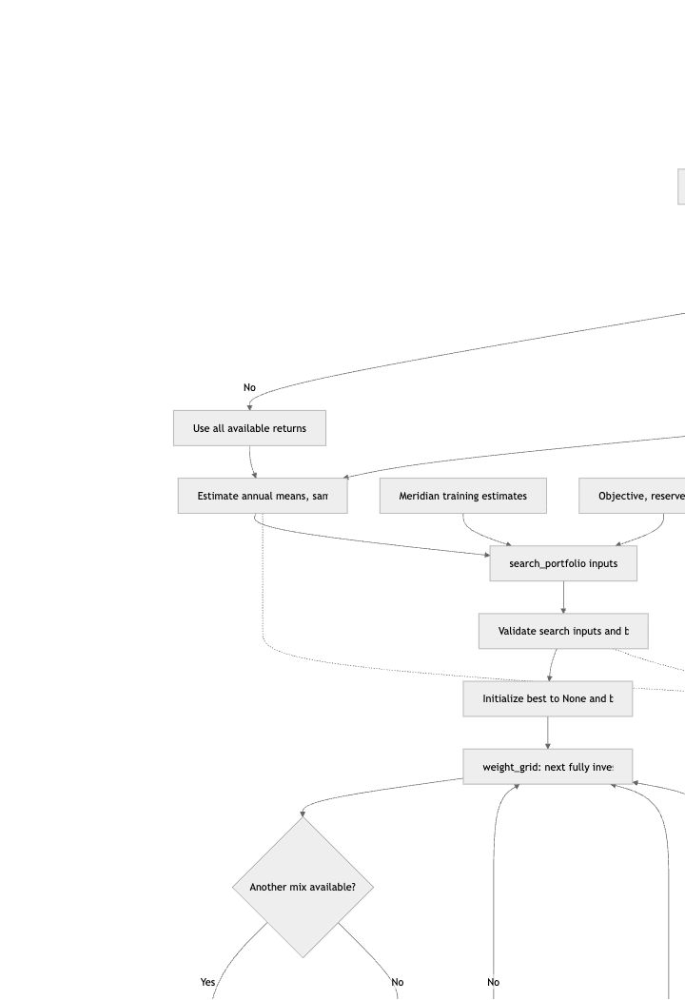
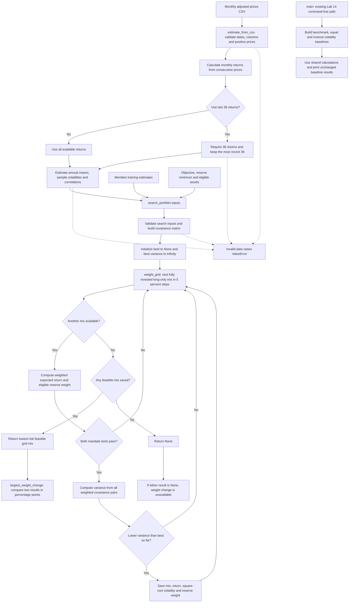

# FIN 439 — Lab 15: Portfolio Stability Decision

October 22, 2026. Campus Opportunity Scholarship Fund. Publication and submission status are recorded in submission-receipt.md.

## R — Represent

Question: Which mix carries the least risk while meeting the mandate, and does the answer survive a one-point change in one estimate?

| Input | Meridian training case | My fictional scholarship fund |
|---|---|---|
| Assets | Bills, 10-year Treasury note, IG bonds, global equity | BIL, IEF, LQD, VT |
| Inputs | Course-authored annual returns, volatilities and correlations in portfolio.py | Historical estimates from prices.csv |
| Objective | 6.5% | 6.5% nominal annual return target |
| Reserve minimum | 3% | 10% |
| Eligible reserve sleeves | Bills and 10-year note | BIL only |
| Horizon | Course training case | At least ten years |

My fictional Campus Opportunity Scholarship Fund starts with $1 million and plans $40,000 annual scholarship distributions. The 6.5% target combines a 4% spending rate with an assumed 2.5% inflation rate; neither is a guaranteed investment outcome. The 10% BIL minimum initially covers 2.5 years of planned distributions. See prework.md for the full mandate, fund roles and source links.

Data: Yahoo monthly adjusted-close observations for October 2021 through September 2026. Downloaded October 22, 2026. The file contains 60 price rows and yields 59 monthly returns. Last-36 means the most recent 36 return observations, using 37 price levels. Missing or nonpositive data, repeated/out-of-order months and gaps are rejected rather than filled. Annual return estimates are mean × 12, sample volatility is standard deviation × √12, and sample correlations use the same monthly observations. Simple annualization assumes independent monthly returns; it does not calculate compounded growth. History is not a forecast.

## I — Implement

The updated portfolio.py keeps all Lab 14 inputs, calculation functions and printed results unchanged. Added functions:

- weight_grid: generates every fully invested, long-only mix in five-percentage-point steps.
- search_portfolio: filters mixes by objective and reserve minimum, then retains the lowest-volatility feasible mix; returns None if none qualifies.
- estimate_from_csv: reads monthly adjusted prices and estimates annual return, volatility and correlation using all available monthly returns or the last 36.
- largest_weight_change: reports the largest absolute allocation change in percentage points when both runs have a mix.

app.py imports the shared engine and Meridian inputs. Its sidebar starts with a 6.5% objective and 3% reserve minimum. It includes a CSV upload and last-36 switch. Each asset has an editable expected-return box and a reserve-eligibility checkbox. The page compares original full-history estimates with the selected window/edited estimates under the same currently selected mandate controls. Results show weights, return, volatility and reserve weight to two decimals, or “no mix meets the objective.” The largest weight change appears below. A reset button restores expected returns to the selected window's estimates.

Under the title: “Built with AI help, a learning demonstration, not investment advice.”

The answer is the lowest-risk point on a 5-point grid, not a continuous optimum. A reserve floor of 3% requires at least 5% on this grid. With several assets marked eligible, their weights are added. A full mandate checker may include additional rules beyond the app's return and reserve tests.

## I.4 — Flowchart of portfolio.py

This chart was checked against the current function bodies in `portfolio.py`. It covers the Python calculation engine only. The ETF download service and Streamlit interface are outside this diagram.



<details>
<summary>Mermaid source</summary>



</details>

### How to explain the path

1. Turn each pair of consecutive monthly prices into a return. Choose all returns or the last 36 **before** estimating means, volatility and correlations.
2. Annualize the mean and sample volatility, then build covariance from correlation and the two volatilities. These are historical estimates, not forecasts.
3. Generate every valid 5-point allocation. For each mix, calculate expected return and eligible reserves; discard it if either rule fails.
4. Compare the remaining mixes by variance. Keeping the smallest variance also keeps the smallest volatility because square root preserves the ordering of nonnegative values.
5. Return the best mix with volatility, or `None` if no mix qualifies. Compare two successful runs using the largest absolute weight change in percentage points.

**Code details:** the four-asset grid contains 1,771 mixes. Both cross-asset covariance directions are included in the double sum. Search comparisons use small floating-point tolerances; ties retain the first mix encountered. There must be at least 37 price levels for 36 returns. CSV dates and prices are validated; zero-volatility return series are rejected. The diagram groups these validation details rather than pretending every statement is a separate conceptual step.

**Compare with your paper drawing:** any unfamiliar box is a question to work through from the code.

## Run it from my FIN 439 folder

Double-click Start-Lab15.command, or run:

```sh
cd /Users/rohan_alwyn/Desktop/FIN439/Lab15
../.venv/bin/python portfolio.py
../.venv/bin/python -m streamlit run app.py --server.address 127.0.0.1 --server.port 8502 --browser.gatherUsageStats false
```

Open http://127.0.0.1:8502. If the app is already running, use its open tab rather than starting a second copy on the same port. Ctrl+C stops the terminal server.

The class environment is Desktop/FIN439/.venv, using Python 3.12.14 with Streamlit 1.66.1 and yfinance 1.7.0. The engine itself remains standard library only. requirements.txt lists the direct packages and requirements-lock.txt records the installed versions.

## Development checks completed

Lab 14 stdout matches the prior results byte-for-byte. The four-asset search enumerates 1,771 fully invested grid allocations. CSV estimation produces 59 or 36 returns as selected. The app renders without exceptions and handles an infeasible target. The complete published-case validation is recorded below.

## Interactive demo upgrade

The app now includes four data modes: Meridian training, the saved scholarship fund demo, direct ETF ticker entry, and CSV upload. Direct entry accepts three to six tickers and fetches five years of completed monthly **Adj Close** from Yahoo Finance through the unofficial yfinance client, with no API key or paid account. It rejects incomplete history and gaps, exposes source/time/period metadata and caches each query for one hour. BIL, IEF, QQQ and SPY are editable demo inputs, not a replacement for the documented BIL/IEF/LQD/VT scholarship-fund universe.

Added allocation comparison bars, rebased individual ETF price histories, correlations, a one-point stress button, restoration of estimates, and scenario JSON/price CSV downloads. Historical ETF charts are not optimized-portfolio backtests. The engine's calculation functions remain shared with the app.

## V — Published Meridian validation

Order: bills / 10-year note / IG bonds / equity. All figures below are computed, not entered as answers.

| Run | Weights (%) | Return | Volatility | Reserve eligible |
|---|---|---:|---:|---:|
| Original inputs | 0 / 20 / 25 / 55 | 6.51% | 9.44% | 20.00% |
| Equity return 8% → 7% | 0 / 10 / 10 / 80 | 6.53% | 12.94% | 10.00% |
| IG–equity correlation 0.25 → 0.50 in both cells | 0 / 40 / 0 / 60 | 6.52% | 9.73% | 40.00% |

The first stress produces a **25-percentage-point** maximum weight movement: equity rises from 55% to 80%. All runs keep the objective at 6.5% and reserve floor at 3%. Lower equity's estimated return means more equity is needed to clear the same return target, so the selected portfolio becomes riskier.

These cases were also checked in the browser. The correlation probe initially exposed stale Python-module imports: browser refresh retained the old module. app.py now reloads the shared engine on rerun; after saving both 0.50 cells and refreshing, the browser showed 6.52% return and 9.73% volatility. Both cells were restored to 0.25 and the original 6.51% / 9.44% answer was confirmed again. Lab 14 stdout still matches the prior file. See validation.txt, executed-results.json and evidence/.

## My universe — all months versus 36 months

The submitted Project 2 universe remains **BIL / IEF / LQD / VT**. Objective: **6.5%**. Only **BIL** counts toward the **10%** reserve minimum. The user-selected QQQ/SPY ticker-entry view is an additional demo; it does not silently replace the documented project universe.

The actual prices.csv was uploaded through the app's CSV path. The estimates use identical monthly observations for all assets, sample standard deviations and correlations. No prices are filled. Both windows meet the objective and reserve floor.

| Window | BIL / IEF / LQD / VT (%) | Expected return | Volatility | Reserve weight |
|---|---|---:|---:|---:|
| All 59 available monthly returns | 60 / 0 / 0 / 40 | 6.61% | 6.05% | 60.00% |
| Last 36 monthly returns | 85 / 0 / 0 / 15 | 6.75% | 1.79% | 85.00% |

Largest allocation change: **25 points**. VT falls from 40% to 15%, and BIL rises by the same amount. The recent window estimates a much higher annualized VT mean (20.25% versus 11.05% on all months), so a smaller equity weight can reach the fixed 6.5% target. Volatility and correlation estimates also change. This is sensitivity to the sample, not evidence that the recent mix is safer in future or that the historical mean will persist. Displayed returns are arithmetic annualizations, not guaranteed rolling-five-year compound performance.

## Explain the search code

1. `n = len(returns)` sets the number of assets; the next checks require 3–6 matching inputs and finite return/objective values, with a reserve floor between 0 and 1.
2. `covariance_matrix(...)` validates the correlations and volatilities, then computes each covariance from correlation and the two annual volatilities.
3. `best = None` means no acceptable mix has been found; `best_variance = math.inf` ensures the first feasible mix can become the best.
4. `for weights in weight_grid(n)` visits every nonnegative five-point allocation whose weights sum to one. With four assets, there are 1,771 distinct mixes.
5. `portfolio_return(...)` computes the weighted average return; `reserve_weight(...)` adds only eligible weights.
6. The `if not meets_objective(...) or reserve < ...` line skips any mix that fails either requirement. `continue` advances to the next mix without comparing its risk.
7. `portfolio_variance(...)` sums the covariance contribution of every asset pair, including both directions of each cross term.
8. If variance is lower than the best seen so far, the engine stores the mix, its return, square-root volatility and reserve weight. Tiny tolerances avoid floating-point boundary errors; ties retain the first mix encountered.
9. `return best` returns the lowest-risk feasible grid point, or None if nothing passed. The app displays the latter honestly rather than relaxing the target.

**Partner question:** why compare variance instead of volatility? **Answer:** square root is increasing for nonnegative numbers, so minimizing variance selects the same mix as minimizing volatility; volatility is still returned for interpretation.

## Partner attack

Partner for this session: Codex, following the instructor permission reported by the student because the human teammate was absent. The challenge targets VT's full-history annualized expected return, since a historical mean is an uncertain forecast proxy. The attack subtracts **one percentage point** from the unrounded 11.0502% estimate to 10.0502% (boxes display 11.05% → 10.05%), holding volatility, correlations, the objective, and reserve rule fixed. This was executed through the app's stress button and checked against the engine.

| Run | BIL / IEF / LQD / VT (%) | Return | Volatility | Reserve |
|---|---|---:|---:|---:|
| As loaded | 60 / 0 / 0 / 40 | 6.61% | 6.05% | 60.00% |
| VT estimate minus 1 point | 55 / 0 / 0 / 45 | 6.53% | 6.79% | 55.00% |

**Two-sentence response:** Lowering VT's estimated return by one percentage point moves five percentage points from BIL into VT and increases estimated volatility from 6.05% to 6.79%, while the 6.5% objective and 10% reserve floor remain satisfied. The higher equity allocation is required to replace the reduced expected return, so the result supports a pilot rather than immediate adoption.

## My call

**Pilot** the full-history 60% BIL / 40% VT mix as the Project 2 starting allocation, rather than adopt it as a final client policy. It clears the modeled objective and reserve constraint, but changing the window shifts 25 points and a one-point VT-return reduction shifts another five points toward equity. Adopt only after forward-looking return assumptions and additional non-overlapping/stress windows support the mandate without a material allocation change, and the committee approves the reserve/spending interpretation. Reopen or reject the starting mix if the fixed target becomes infeasible or the scholarship reserve requirement is breached; do not lower the objective to manufacture an answer.

For a concrete stability review trigger in this project, treat a movement greater than 10 percentage points under a plausible one-point return stress or alternate window as requiring committee review before adoption. This is a proposed governance judgment, not a course-prescribed cutoff or a cap inserted into the optimization. The observed 25-point window shift already triggers review.

## Estimation risk — learn and reflect

Estimation risk is the risk that assumed returns, volatilities or correlations differ from their future values. The optimizer treats those estimates as inputs to a strict return/constraint test; a small change can move the boundary enough to select a different five-point mix, especially near the return target. A precise solution to uncertain inputs is still uncertain.

My own window comparison moves a quarter of the portfolio because recent VT returns look much stronger than the five-year sample, with different covariance estimates as well. Before adoption I would want a credible forward-looking return range, performance under adverse equity and bond scenarios, more than one historical window, explicit scholarship cash-flow timing and confirmation that the spending/inflation target is being measured consistently. Historical low volatility does not establish protection from future losses.

## Delivery

See CHECKLIST.md for the requirement audit, FILE-MANIFEST.json for the package contents, and submission-receipt.md for verified publication and checkout status.
